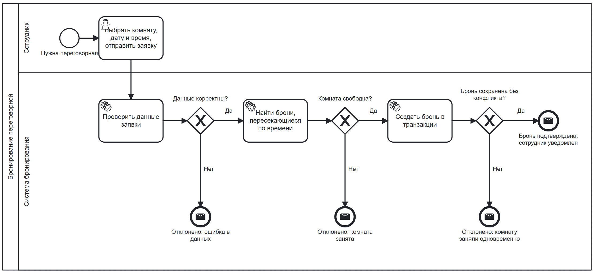
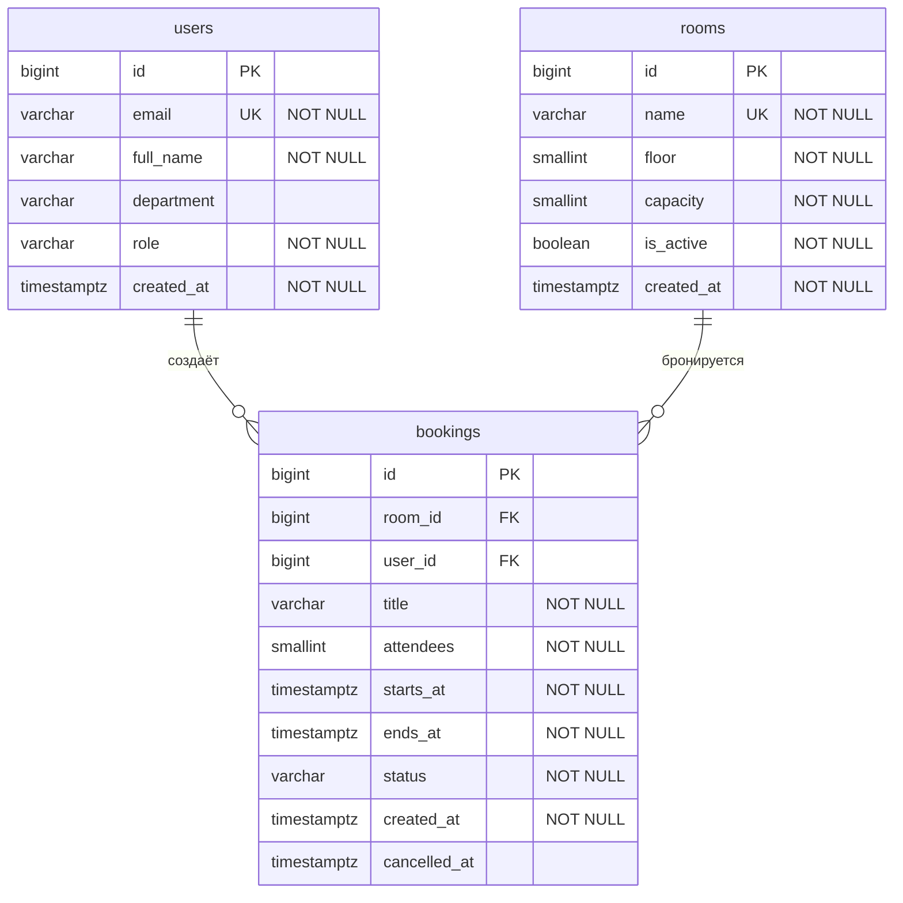

# Кейс 2. Сервис бронирования переговорных

Проектирование системы бронирования переговорных комнат для сотрудников компании: бизнес-процесс, модель данных, требования в виде User Stories и защита от двойного бронирования.

**Фокус:** BPMN, проектирование БД, User Stories, Acceptance Criteria (Gherkin), конкурентный доступ.
**Артефакты:** BPMN 2.0 ([`booking-process.bpmn`](./docs/booking-process.bpmn)), ERD, SQL-схема PostgreSQL, 3 User Stories с 15 сценариями.

> Уточнение: это проектная документация, а не рабочий код. SQL-схема была проверена на PostgreSQL 16.

---

## 1. Контекст и границы

**Задача.** В офисе несколько переговорных. Сейчас их бронируют в чате и таблицах, из-за чего разные команды регулярно приходят в одну комнату в одно время. Нужен сервис, где сотрудник за минуту находит свободную комнату и бронирует её, а система гарантирует, что одно и то же время не достанется двоим.

**Роли**

| Роль | Что делает |
|---|---|
| Сотрудник | Ищет свободные комнаты, бронирует, отменяет свои брони |
| Администратор | То же, что и сотрудник, плюс отменяет любые брони и отключает комнаты |

**В рамках кейса:** поиск свободных комнат, создание и отмена брони, защита от пересечений.
**Вне рамок:** повторяющиеся встречи, интеграция с календарём, согласование брони руководителем, оплата, уведомления по почте (показаны в схеме как результат, но без деталей доставки сообщений).

---

## 2. Бизнес-правила

| № | Правило |
|---|---|
| BR-1 | Время начала брони должно быть в будущем |
| BR-2 | Время окончания позже времени начала |
| BR-3 | Длительность брони от 15 минут до 4 часов |
| BR-4 | Число участников не больше вместимости комнаты |
| BR-5 | У одной комнаты не может быть двух подтверждённых броней с пересекающимся временем. Но интервал полуоткрытый, поэтому бронь 10:00-11:00 и бронь 11:00-12:00 не пересекаются. |
| BR-6 | Бронировать можно только активные комнаты |
| BR-7 | Бронь отменяет её автор или администратор, и только до начала встречи |

---

## 3. BPMN: процесс бронирования



Файл [`booking-process.bpmn`](./docs/booking-process.bpmn) можно открыть и редактировать в [bpmn.io](https://demo.bpmn.io/) или Camunda Modeler.

**Пояснения по схеме**

1. Сотрудник выбирает комнату, дату, время и отправляет заявку.
2. Система проверяет данные по привилам BR-1 - BR-4 и BR-6. Если данные некорректны, заявка отклоняется (шлюз «Данные корректны?»).
3. Система ищет брони, пересекающиеся по времени. Если комната занята, заявка отклоняется (шлюз «Комната свободна?»).
4. Если комната свободна, бронь создаётся в транзакции.
5. Второй раз конфликт проверяется уже при сохранении (шлюз «Бронь сохранена без конфликта?»). Это защита от ситуации, когда между проверкой и сохранением другой сотрудник успел занять комнату (раздел 7).
6. Процесс заканчивается одним из четырёх исходов, каждый из которых отправляет сообщение сотруднику с результатом: бронь подтверждена / отказ с причиной.

---

## 4. ERD: модель данных



**Связи**

| Связь | Тип | Смысл |
|---|---|---|
| `users` - `bookings` | один ко многим | Сотрудник создаёт много броней, у брони один автор |
| `rooms` - `bookings` | один ко многим | Комната бронируется много раз, бронь относится к одной комнате |

### Таблица `users`

| Поле | Тип | Ограничения | Описание |
|---|---|---|---|
| `id` | BIGINT | PK, identity | Идентификатор |
| `email` | VARCHAR(255) | NOT NULL, UNIQUE | Рабочая почта, используется как логин |
| `full_name` | VARCHAR(150) | NOT NULL | ФИО |
| `department` | VARCHAR(100) | | Подразделение |
| `role` | VARCHAR(20) | NOT NULL, default `employee`, CHECK | `employee` или `admin` |
| `created_at` | TIMESTAMPTZ | NOT NULL, default `now()` | Дата создания |

### Таблица `rooms`

| Поле | Тип | Ограничения | Описание |
|---|---|---|---|
| `id` | BIGINT | PK, identity | Идентификатор |
| `name` | VARCHAR(100) | NOT NULL, UNIQUE | Название комнаты |
| `floor` | SMALLINT | NOT NULL | Этаж |
| `capacity` | SMALLINT | NOT NULL, CHECK (> 0) | Вместимость |
| `is_active` | BOOLEAN | NOT NULL, default `true` | Доступна ли для бронирования (BR-6) |
| `created_at` | TIMESTAMPTZ | NOT NULL, default `now()` | Дата создания |

### Таблица `bookings`

| Поле | Тип | Ограничения | Описание |
|---|---|---|---|
| `id` | BIGINT | PK, identity | Идентификатор |
| `room_id` | BIGINT | NOT NULL, FK -> `rooms.id` | Комната |
| `user_id` | BIGINT | NOT NULL, FK -> `users.id` | Автор брони |
| `title` | VARCHAR(200) | NOT NULL | Тема встречи |
| `attendees` | SMALLINT | NOT NULL, default 1, CHECK (> 0) | Число участников |
| `starts_at` | TIMESTAMPTZ | NOT NULL | Начало |
| `ends_at` | TIMESTAMPTZ | NOT NULL, CHECK (> `starts_at`) | Окончание |
| `status` | VARCHAR(20) | NOT NULL, default `confirmed`, CHECK | `confirmed` или `cancelled` |
| `created_at` | TIMESTAMPTZ | NOT NULL, default `now()` | Дата создания |
| `cancelled_at` | TIMESTAMPTZ | CHECK | Заполненяется, только если `status = cancelled` |

**Решения по модели**

* Время хранится в `TIMESTAMPTZ`, чтобы не путаться с часовыми поясами.
* Отмена - смена статуса, а не удаление строки, так как это позволяет сохранить историю. В то время слот освобождается, потому что защита от пересечений действует только для `confirmed`.
* Отклонённые заявки в таблицу не попадают.
* Проверки BR-3 и BR-5 вынесены в ограничения БД (`CHECK` и `EXCLUDE`). Проверки, зависящие от других таблиц или текущего времени (BR-1, BR-4, BR-7), выполняет само приложение.

Полный скрипт: [`sql/schema.sql`](./sql/schema.sql). Тестовые данные и типовые запросы (свободные комнаты, мои брони, расписание комнаты): [`sql/queries.sql`](./sql/queries.sql).

---

## 5. User Stories и Acceptance Criteria

Сценарии лежат в папке [`features/`](./features) в формате Gherkin.

### US-1. Бронирование комнаты

> Как сотрудник, я хочу забронировать переговорную на нужное время и не переживать что эту комнату займёт на то же время кто-то другой.

```gherkin
# language: ru
Функционал: Бронирование переговорной комнаты
  Как сотрудник,
  я хочу забронировать переговорную на нужное время,
  и не переживать, что эту комнату займёт на то же время кто-то другой.

  Контекст:
    Допустим я авторизован как сотрудник "Евгений Евгеньевич"
    И существует активная комната "Байкал" вместимостью 6 человек

  Сценарий: Успешное бронирование свободной комнаты
    Дано комната "Байкал" свободна 16.11.2026 с 10:00 до 11:00
    Когда я бронирую комнату "Байкал" на 16.11.2026 с 10:00 до 11:00 с темой "Планирование спринта" на 4 участников
    Тогда система создаёт бронь со статусом "confirmed"
    И я вижу подтверждение с названием комнаты и временем встречи
    И комната "Байкал" становится занятой на этот период

  Сценарий: Комната занята на выбранное время
    Дано комната "Байкал" уже забронирована 16.11.2026 с 10:00 до 11:00
    Когда я бронирую комнату "Байкал" на 16.11.2026 с 10:00 до 11:00
    Тогда система отклоняет заявку с ошибкой "Комната занята на выбранное время"
    И новая бронь не создаётся

  Структура сценария: Пересечение интервалов времени (см. таблицу)
    Дано комната "Байкал" уже забронирована 16.11.2026 с 10:00 до 11:00
    Когда я бронирую комнату "Байкал" на 16.11.2026 с <начало> до <конец>
    Тогда результат бронирования: <результат>

    Примеры:
      | начало | конец | результат    | пояснение                         |
      | 09:30  | 10:30 | отклонена    | пересекается с началом чужой брони |
      | 10:30  | 11:30 | отклонена    | пересекается с концом чужой брони  |
      | 10:15  | 10:45 | отклонена    | целиком внутри чужой брони         |
      | 09:00  | 12:00 | отклонена    | полностью накрывает чужую бронь    |
      | 11:00  | 12:00 | подтверждена | начинается ровно в момент окончания |
      | 09:00  | 10:00 | подтверждена | заканчивается ровно в момент начала |

  Сценарий: Время начала в прошлом
    Дано текущее время 16.11.2026 09:00
    Когда я бронирую комнату "Байкал" на 16.11.2026 с 08:00 до 09:00
    Тогда система отклоняет заявку с ошибкой "Время начала должно быть в будущем"

  Сценарий: Время окончания раньше времени начала
    Когда я бронирую комнату "Байкал" на 16.11.2026 с 11:00 до 10:00
    Тогда система отклоняет заявку с ошибкой "Время окончания должно быть позже времени начала"

  Сценарий: Превышена максимальная длительность брони
    Когда я бронирую комнату "Байкал" на 16.11.2026 с 09:00 до 14:00
    Тогда система отклоняет заявку с ошибкой "Максимальная длительность брони - 4 часа"

  Сценарий: Участников больше, чем вмещает комната
    Когда я бронирую комнату "Байкал" на 16.11.2026 с 10:00 до 11:00 на 8 участников
    Тогда система отклоняет заявку с ошибкой "Число участников превышает вместимость комнаты (6)"

  Сценарий: Комната отключена от бронирования
    Дано комната "Алтай" помечена как неактивная
    Когда я бронирую комнату "Алтай" на 16.11.2026 с 10:00 до 11:00
    Тогда система отклоняет заявку с ошибкой "Комната недоступна для бронирования"

  Сценарий: Два сотрудника одновременно бронируют одну комнату
    Дано комната "Байкал" свободна 16.11.2026 с 15:00 до 16:00
    Когда два сотрудника одновременно отправляют заявки на комнату "Байкал" на 16.11.2026 с 15:00 до 16:00
    Тогда ровно одна заявка подтверждается
    И вторая отклоняется с ошибкой "Комната занята на выбранное время"
    И в базе данных нет пересекающихся подтверждённых броней этой комнаты
```

### US-2. Отмена брони

> Как сотрудник, я хочу отменить свою бронь, чтобы освободить комнату для коллег, если встреча не состоится.

```gherkin
# language: ru
Функционал: Отмена брони
  Как сотрудник,
  я хочу отменить свою бронь,
  чтобы освободить комнату для коллег, если встреча не состоится.

  Сценарий: Автор отменяет свою будущую бронь
    Дано я авторизован как сотрудник "Евгений Евгеньевич"
    И у меня есть подтверждённая бронь комнаты "Байкал" на 16.11.2026 с 10:00 до 11:00
    И текущее время 14.11.2026 12:00
    Когда я отменяю эту бронь
    Тогда бронь получает статус "cancelled" и время отмены
    И комната "Байкал" снова свободна на этот период

  Сценарий: Сотрудник не может отменить чужую бронь
    Дано я авторизован как сотрудник "Евгений Евгеньевич"
    И существует подтверждённая бронь сотрудника "Мария Петрова"
    Когда я пытаюсь отменить эту бронь
    Тогда система отклоняет запрос с ошибкой "Нельзя отменить чужую бронь"
    И статус брони не меняется

  Сценарий: Администратор может отменить любую бронь
    Дано я авторизован как администратор
    И существует подтверждённая бронь сотрудника "Мария Петрова"
    Когда я отменяю эту бронь
    Тогда бронь получает статус "cancelled"

  Сценарий: Нельзя отменить бронь, которая уже началась
    Дано у меня есть подтверждённая бронь на 16.11.2026 с 10:00 до 11:00
    И текущее время 16.11.2026 10:30
    Когда я отменяю эту бронь
    Тогда система отклоняет запрос с ошибкой "Нельзя отменить бронь, которая уже началась"
```

### US-3. Поиск свободных комнат

> Как сотрудник, я хочу увидеть свободные комнаты на нужное время и число участников, чтобы быстро выбрать подходящую.

```gherkin
# language: ru
Функционал: Поиск свободных комнат
  Как сотрудник,
  я хочу увидеть свободные комнаты на нужное время и число участников,
  чтобы быстро выбрать подходящую и не перебирать их вручную.

  Контекст:
    Допустим существуют активные комнаты:
      | название | вместимость |
      | Байкал   | 6           |
      | Эльбрус  | 12          |
      | Алтай    | 4           |

  Сценарий: Показываются только свободные комнаты достаточной вместимости
    Дано комната "Эльбрус" занята 16.11.2026 с 10:00 до 11:00
    Когда я ищу комнату на 16.11.2026 с 10:00 до 11:00 для 5 участников
    Тогда я вижу только комнату "Байкал"

  Сценарий: Подходящих комнат нет
    Дано все комнаты вместимостью от 5 человек заняты 16.11.2026 с 10:00 до 11:00
    Когда я ищу комнату на 16.11.2026 с 10:00 до 11:00 для 5 участников
    Тогда я вижу сообщение "Свободных комнат на это время нет"
    И мне предлагается изменить время или число участников
```

---

## 6. Трассируемость: правило, сценарий, реализация

| Правило | Где проверяется | Сценарий |
|---|---|---|
| BR-1 | Приложение | US-1: время начала в прошлом |
| BR-2 | БД (`chk_bookings_period`) | US-1: окончание раньше начала |
| BR-3 | БД (`chk_bookings_duration`) | US-1: превышена длительность |
| BR-4 | Приложение | US-1: участников больше вместимости |
| BR-5 | БД (`no_overlapping_bookings`) | US-1: комната занята, пересечение интервалов, одновременные заявки |
| BR-6 | Приложение | US-1: комната отключена |
| BR-7 | Приложение | US-2: все сценарии |

---

## 7. Гонка данных: два человека бронируют одну комнату

**Проблема.** Если сервис сначала делает `SELECT` («свободно ли?»), а потом `INSERT`, то две заявки, пришедшие одновременно, обе увидят «свободно» и обе создадут бронь:

```
Сотрудник A: SELECT пересечений -> 0       Сотрудник B: SELECT пересечений -> 0
Сотрудник A: INSERT брони (10:00-11:00)    Сотрудник B: INSERT брони (10:00-11:00)
                    -> две брони на одну комнату и одно время
```

**Варианты решения**

| Подход | Как работает | Плюсы | Минусы |
|---|---|---|---|
| **`EXCLUDE`-ограничение (выбрано)** | БД сама запрещает пересекающиеся интервалы у одной комнаты | Гарантия на уровне данных, работает при любом числе сервисов и любом способе записи, без ручных блокировок | Специфично для PostgreSQL, нужно расширение `btree_gist` |
| Блокировка строки комнаты (`SELECT ... FOR UPDATE`) | Заявки на одну комнату выстраиваются в очередь, проверка и вставка идут по очереди | Работает в любой СУБД | Нужно не забыть блокировку в каждом месте записи, брони одной комнаты обрабатываются последовательно |
| Уровень изоляции `SERIALIZABLE` | СУБД сама обнаруживает конфликтующие транзакции | Не нужны явные блокировки | Транзакции откатываются с ошибкой `40001`, приложение обязано повторять попытку |

**Как это работает в нашем решении**

1. Приложение выполняет проверку (шлюз «Комната свободна?») ради понятного ответа пользователю.
2. `INSERT` выполняется в транзакции. Если между проверкой и вставкой комнату успели занять, PostgreSQL отклоняет вставку с кодом `23P01` (`exclusion_violation`).
3. Приложение перехватывает эту ошибку и возвращает «Комната занята на выбранное время» (HTTP 409). Это соответствует нижнему шлюзу на BPMN-схеме.

**Проверка.** На PostgreSQL 16 две параллельные транзакции бронировали одну комнату на одно время. Без защиты (проверка, затем вставка) в таблице оказалось 2 брони. С ограничением `no_overlapping_bookings` подтверждена одна, вторая получила `23P01`. Бронь встык (10:00-11:00 и 11:00-12:00) разрешена.

---

## 8. Допущения

* Рабочее время и выходные не ограничены, комната доступна круглосуточно.
* Один сотрудник может иметь пересекающиеся брони в разных комнатах.
* Часовой пояс офиса один, время передаётся клиентом с указанием смещения.
* Значения BR-3 (15 минут и 4 часа) выбраны для примера и в реальном проекте согласуются с заказчиком.

---

## 9. Структура репозитория

```
├── README.md
├── docs/
│   ├── booking-process.bpmn      # BPMN, открывается в bpmn.io
│   └── booking-process.png       # та же схема в виде изображения
├── features/
│   ├── 01_create_booking.feature
│   ├── 02_cancel_booking.feature
│   └── 03_find_free_rooms.feature
└── sql/
    ├── schema.sql                # таблицы, ограничения, индексы
    └── queries.sql               # тестовые данные и типовые запросы
```
